<div align="center">
  
</div>

# 📄 CyrusAsha_GuiForOpenDataLoaderPDF-1.0.0

[](https://www.microsoft.com/windows)
[](https://www.python.org/downloads/)
[-success)](#-project-structure--ساختار-پروژه)
[](#-page-guide--راهنمای-صفحهها)
[](https://github.com/opendataloader-project/opendataloader-pdf)
[](LICENSE)

**نسخه / Version: `1.0.0`**  
**زبان‌های رابط / UI languages: فارسی و English**

<div dir="rtl">

مرکز کنترل گرافیکی، سبک و دوزبانه برای **OpenDataLoader PDF** — نصب، تبدیل، پیش‌نمایش و مدیریت همه‌چیز از یک‌جا، کاملاً محلی.

</div>

A lightweight, bilingual graphical control center for **OpenDataLoader PDF** — install, convert, preview and manage everything from one place, fully local.

---

## 📑 Contents / فهرست مطالب

<div dir="rtl">

۱. [معرفی](#-introduction--معرفی) · ۲. [قابلیت‌ها](#-features--قابلیتها) · ۳. [اصلاح خروجی فارسی](#-persian--rtl-output-repair--اصلاح-خروجی-فارسی-و-راستبهچپ) · ۴. [تصاویر](#️-screenshots--تصاویر) · ۵. [پیش‌نیازها](#-requirements--پیشنیازها) · ۶. [نصب و اجرا](#-installation--first-run--نصب-و-اجرا) · ۷. [محل نصب و مدل‌ها](#-install--models-folders--محل-نصب-و-مدلها) · ۸. [راهنمای صفحه‌ها](#-page-guide--راهنمای-صفحهها) · ۹. [حالت هیبرید](#-hybrid-mode-ai--حالت-هیبرید-هوش-مصنوعی) · ۱۰. [نکته پایتون ۳.۱۵](#️-python-315-note--نکته-پایتون-۳۱۵) · ۱۱. [خط فرمان](#️-command-line--خط-فرمان) · ۱۲. [ساختار پروژه](#-project-structure--ساختار-پروژه) · ۱۳. [آزمون و ساخت](#-tests--release-build--آزمون-و-ساخت-انتشار) · ۱۴. [حریم خصوصی و امنیت](#-privacy--security--حریم-خصوصی-و-امنیت) · ۱۵. [رفع اشکال](#️-troubleshooting--رفع-اشکال) · ۱۶. [حذف](#️-uninstall--حذف-برنامه) · ۱۷. [Git و GitHub](#-git--github--git-و-github) · ۱۸. [مشارکت](#-contributing--مشارکت) · ۱۹. [مجوز](#-license--مجوز)

</div>

1. [Introduction](#-introduction--معرفی) · 2. [Features](#-features--قابلیتها) · 3. [Persian & RTL output repair](#-persian--rtl-output-repair--اصلاح-خروجی-فارسی-و-راستبهچپ) · 4. [Screenshots](#️-screenshots--تصاویر) · 5. [Requirements](#-requirements--پیشنیازها) · 6. [Installation & first run](#-installation--first-run--نصب-و-اجرا) · 7. [Install & models folders](#-install--models-folders--محل-نصب-و-مدلها) · 8. [Page guide](#-page-guide--راهنمای-صفحهها) · 9. [Hybrid mode](#-hybrid-mode-ai--حالت-هیبرید-هوش-مصنوعی) · 10. [Python 3.15 note](#️-python-315-note--نکته-پایتون-۳۱۵) · 11. [Command line](#️-command-line--خط-فرمان) · 12. [Project structure](#-project-structure--ساختار-پروژه) · 13. [Tests & build](#-tests--release-build--آزمون-و-ساخت-انتشار) · 14. [Privacy & security](#-privacy--security--حریم-خصوصی-و-امنیت) · 15. [Troubleshooting](#️-troubleshooting--رفع-اشکال) · 16. [Uninstall](#️-uninstall--حذف-برنامه) · 17. [Git & GitHub](#-git--github--git-و-github) · 18. [Contributing](#-contributing--مشارکت) · 19. [License](#-license--مجوز)

---

## 📌 Introduction / معرفی

<div dir="rtl">

برنامه‌ی `CyrusAsha_GuiForOpenDataLoaderPDF-1.0.0` یک مرکز کنترل محلی برای پروژه‌ی متن‌باز [opendataloader-pdf](https://github.com/opendataloader-project/opendataloader-pdf) است؛ ابزاری که PDF را به Markdown، JSON (همراه با مختصات هر عنصر)، HTML، متن ساده، PDF حاشیه‌نویسی‌شده و Tagged PDF تبدیل می‌کند و برای RAG و مدل‌های زبانی ساخته شده است. این برنامه خود پروژه را نصب می‌کند و همه‌ی کارها را از یک رابط گرافیکی فارسی/انگلیسی مدیریت می‌کند.

</div>

`CyrusAsha_GuiForOpenDataLoaderPDF-1.0.0` is a local control center for the open-source project [opendataloader-pdf](https://github.com/opendataloader-project/opendataloader-pdf) — a tool that converts PDFs into Markdown, JSON (with the bounding box of every element), HTML, plain text, annotated PDF and Tagged PDF, built for RAG and LLM pipelines. This program installs the project itself and manages every task from a Persian/English graphical interface.

<div dir="rtl">

خود برنامه هیچ وابستگی‌ای ندارد: بک‌اند فقط از کتابخانه‌ی استاندارد پایتون استفاده می‌کند و رابط کاربری HTML/CSS/JavaScript خالص و بدون مرحله‌ی build است که در پنجره‌ی Edge (همراه ویندوز) باز می‌شود. همه‌چیز — محیط پایتون، Java، خروجی‌ها و تنظیمات — داخل پوشه‌ی `data` همین پروژه ذخیره می‌شود، پس برنامه کاملاً قابل‌حمل است.

</div>

The program itself has no dependencies: the backend uses only the Python standard library, and the UI is plain HTML/CSS/JavaScript without a build step, opened in an Edge window (built into Windows). Everything — the Python environment, Java, outputs and settings — is stored inside this project's `data` folder, so the program is fully portable.

<div dir="rtl">

**معنای نام:** `CyrusAsha_GuiForOpenDataLoaderPDF` یعنی «رابط گرافیکی CyrusAsha برای OpenDataLoader PDF»؛ این برنامه خودِ opendataloader-pdf یا انشعابی از آن نیست، بلکه یک رابط گرافیکی برای نصب و مدیریت آن است.

</div>

**About the name:** `CyrusAsha_GuiForOpenDataLoaderPDF` means “CyrusAsha GUI for OpenDataLoader PDF”; it is not opendataloader-pdf itself or a fork of it, but a graphical interface that installs and manages it.

---

## ✨ Features / قابلیت‌ها

### 📦 Installation & maintenance / نصب و نگه‌داری

<div dir="rtl">

- **نصب با یک کلیک:** ساخت محیط مجازی پایتون اختصاصی (`venv` در پوشه‌ی نصب)، نصب `opendataloader-pdf` از PyPI و اجرای آزمون خودکار؛ پایتون سیستم تغییری نمی‌کند.
- **Java خودکار و قابل‌حمل:** اگر Java 11+ پیدا نشود، Eclipse Temurin (۱۷، ۲۱ یا ۲۵) از API رسمی Adoptium دانلود، با **SHA-256** بررسی و در پوشه‌ی `java` نصب می‌شود — **بدون دسترسی مدیر**. نصب سیستمی با `winget` یا انتخاب مسیر دلخواه هم ممکن است.
- **به‌روزرسانی و بازگشت:** نمایش نسخه‌ی نصب‌شده و آخرین نسخه‌ی PyPI، به‌روزرسانی با یک کلیک و نصب هر نسخه‌ی دلخواه.
- **بخش هیبرید (هوش مصنوعی):** نصب `opendataloader-pdf[hybrid]` (docling، PyTorch، EasyOCR) با **بررسی اولیه‌ی وابستگی‌ها** پیش از دانلود چند گیگابایتی.
- **موتورهای OCR، تعمیر و حذف:** نصب RapidOCR و Tesseract، ساخت دوباره‌ی محیط، حذف بسته یا Java قابل‌حمل؛ همه با نمایش زنده‌ی مراحل، نوار دانلود و گزارش کامل.
- **محل نصب و مدل‌ها به انتخاب شما:** محیط پایتون، Java و کش دانلود (پوشه‌ی نصب) و مدل‌هایی که سرور هیبرید دانلود می‌کند (پوشه‌ی مدل‌ها) را روی هر درایوی بگذارید؛ انتقال فایل‌های فعلی با نوار پیشرفت، نمایش حجم و فضای آزاد، و هشدار مسیر طولانی ([جزئیات](#-install--models-folders--محل-نصب-و-مدلها)).

</div>

- **One-click installation:** creates a private Python virtual environment (`venv` in the install folder), installs `opendataloader-pdf` from PyPI and runs a self-test; the system Python is not modified.
- **Automatic, portable Java:** when no Java 11+ is found, Eclipse Temurin (17, 21 or 25) is downloaded from the official Adoptium API, **SHA-256 verified** and unpacked into the `java` folder — **no administrator rights needed**. A system-wide `winget` install or a custom path are supported as well.
- **Updates and rollback:** installed vs. latest PyPI version, one-click update, and installation of any specific version.
- **Hybrid (AI) extra:** installs `opendataloader-pdf[hybrid]` (docling, PyTorch, EasyOCR) with a **dependency pre-check** before the multi-GB download.
- **OCR engines, repair and removal:** install RapidOCR and Tesseract, recreate the environment, remove the package or the portable Java — all with live steps, a download bar and the full log.
- **Install and models folders of your choice:** put the Python environment, Java and the download cache (install folder) and the models the hybrid server downloads (models folder) on any drive; existing files are moved with progress, with sizes, free space and long-path warnings ([details](#-install--models-folders--محل-نصب-و-مدلها)).

### 🔄 Conversion / تبدیل

<div dir="rtl">

- **کشیدن و رها کردن** فایل‌ها و **پوشه‌ها** (با همه‌ی زیرپوشه‌ها) در هر جای پنجره.
- **انتخاب بدون کپی:** پنجره‌ی بومی ویندوز فایل‌ها را در محل خودشان استفاده می‌کند — مناسب پوشه‌های بزرگ؛ وارد کردن مسیر (حتی مسیر شبکه) هم ممکن است.
- **همه‌ی گزینه‌های CLI** در گروه‌های مرتب: قالب‌ها، صفحات، رمز، متن، جدول، ترتیب خواندن، تصاویر، جداکننده‌ی صفحات، فیلترهای ایمنی، پاک‌سازی، هیبرید و کارایی؛ گزینه‌هایی که نسخه‌های جدیدتر اضافه کنند **خودکار** ظاهر می‌شوند.
- **پیش‌تنظیم‌ها** بر اساس جدول «کدام حالت؟» پروژه‌ی اصلی (RAG، دسترس‌پذیری، عیب‌یابی، اسکن‌شده، فرمول، نمودار…) و ذخیره‌ی پیش‌تنظیم شخصی.
- **پیش‌نمایش زنده‌ی خط فرمان** (قابل کپی) و اعتبارسنجی پیش از اجرا.
- **اصلاح خودکار خروجی فارسی، عربی و عبری:** opendataloader-pdf این متن‌ها را وارونه و با حروف «شکل نمایشی» برمی‌گرداند؛ رابط ترتیب خواندن، حروف، نیم‌فاصله‌ها، لیگاتورها و ستون‌های جدول را در خروجی‌های JSON، Markdown، HTML و متن درست می‌کند ([جزئیات](#-persian--rtl-output-repair--اصلاح-خروجی-فارسی-و-راستبهچپ)).

</div>

- **Drag & drop** files and **folders** (recursively) anywhere in the window.
- **Pick without copying:** the native Windows dialog uses files in place — ideal for large folders; typing a path (even a network path) works too.
- **Every CLI option**, neatly grouped: formats, pages, password, text, tables, reading order, images, page separators, safety filters, sanitization, hybrid and performance; options added by newer releases appear **automatically**.
- **Presets** based on the upstream “Which mode should I use?” table (RAG, accessibility, debugging, scanned, formulas, charts…) plus your own presets.
- **Live command-line preview** (copyable) and validation before running.
- **Automatic repair of Persian, Arabic and Hebrew output:** opendataloader-pdf returns such text reversed and with presentation-form letters; the GUI fixes reading order, letters, half-spaces (ZWNJ), ligatures and table column order in the JSON, Markdown, HTML and text outputs ([details](#-persian--rtl-output-repair--اصلاح-خروجی-فارسی-و-راستبهچپ)).

### 📋 Jobs & output preview / کارها و پیش‌نمایش خروجی

<div dir="rtl">

- **صف کارها** با تعداد هم‌زمان قابل تنظیم؛ همه‌ی فایل‌های یک کار در **یک فراخوانی** CLI پردازش می‌شوند (هر فراخوانی یک JVM جدید است).
- **پیشرفت زنده** («فایل ۳ از ۱۰ — ۱۴ صفحه»)، نتیجه‌ی هر فایل (موفق / رمزدار / ناموفق)، هشدارها و خطاها و **گزارش زنده** با فیلتر.
- **مرورگر خروجی** با پیش‌نمایش Markdown (همراه تصاویر)، خلاصه‌ی JSON، HTML در قاب امن، PDF، متن و تصویر؛ دانلود تکی یا **ZIP**، اجرای دوباره و اعلان دسکتاپ.

</div>

- **Job queue** with configurable parallelism; all files of a job are processed in **one** CLI call (every call starts a new JVM).
- **Live progress** (“file 3 of 10 — 14 pages”), per-file results (OK / password protected / failed), warnings, errors and a **live log** with filtering.
- **Output browser** with previews for Markdown (with images), a JSON summary, sandboxed HTML, PDF, text and images; single-file or **ZIP** download, re-run and desktop notifications.

### 🤖 Hybrid server & more / سرور هیبرید و سایر قابلیت‌ها

<div dir="rtl">

- **مدیریت سرور هیبرید:** اجرا/توقف، وضعیت بارگذاری مدل‌ها، گزارش زنده، همه‌ی گزینه‌های سرور (OCR فارسی، فرمول ← LaTeX، توضیح تصاویر، GPU)، **اجرای خودکار** هنگام نیاز و استفاده از سرور خارجی.
- **ویرایشگر قوانین پاک‌سازی** (`--sanitize-rules`) با اعتبارسنجی رسمی، آزمایش روی متن نمونه و وارد/خارج کردن فایل.
- **هویت CyrusAsha:** لوگو و آیکون چندسایز (۱۶ تا ۲۵۶ پیکسل)، رابط **فارسی/انگلیسی** با راست‌به‌چپ کامل و تاریخ شمسی، پوسته‌ی روشن/تیره، میان‌برهای صفحه‌کلید و میان‌بر دسکتاپ.

</div>

- **Hybrid server management:** start/stop, model-loading state, live log, every server option (Persian OCR, formulas → LaTeX, picture descriptions, GPU), **auto-start** when needed, and external servers.
- **Sanitize-rule editor** (`--sanitize-rules`) with the official validation limits, tests on sample text and import/export.
- **CyrusAsha identity:** logo and a multi-size icon (16–256 px), **Persian/English** UI with full right-to-left layout and the Persian calendar, light/dark theme, keyboard shortcuts and a desktop shortcut.

---

## 🔤 Persian & RTL output repair / اصلاح خروجی فارسی و راست‌به‌چپ

<div dir="rtl">

**مشکل:** opendataloader-pdf متن هر سطر را با مرتب کردن تکه‌های متن **از چپ به راست** می‌سازد. برای فارسی، عربی و عبری نتیجه «ترتیب دیداری» است: حروف و کلمات وارونه‌اند، به‌جای حروف معمولی «شکل‌های نمایشی» (Presentation Forms) مثل `ﺳ ﺴ ﺲ` می‌آید، نیم‌فاصله‌ها گم می‌شوند و ستون‌های جدول از چپ به راست شمرده می‌شوند. پروژه‌ی اصلی این را یک محدودیت شناخته‌شده می‌داند و چنین خروجی‌ای برای جست‌وجو، RAG و مدل‌های زبانی تقریباً بی‌استفاده است.

**راه‌حل:** گزینه‌ی **«اصلاح متن راست‌به‌چپ»** در گروه «متن» (پیش‌فرض: **خودکار**) پس از تبدیل، خروجی‌های JSON، Markdown، HTML و متن را در جای خود درست می‌کند. این گزینه مخصوص رابط است (برچسب «رابط») و به خط فرمان opendataloader-pdf فرستاده نمی‌شود.

</div>

**Problem:** opendataloader-pdf builds every line by sorting the text pieces **from left to right**. For Persian, Arabic and Hebrew this yields the *visual* order: letters and words are reversed, contextual “presentation forms” such as `ﺳ ﺴ ﺲ` replace normal letters, zero-width non-joiners (half-spaces) are lost and table columns are counted from left to right. The upstream project lists this as a known limitation, and such output is nearly useless for search, RAG and language models.

**Solution:** the **“Fix right-to-left text”** option in the “Text” group (default: **Auto**) repairs the JSON, Markdown, HTML and text outputs in place after the conversion. It is a GUI option (marked “GUI”) and is never passed to the opendataloader-pdf command line.

| خروجی خام opendataloader-pdf / Raw opendataloader-pdf output | پس از اصلاح / After the repair |
|---|---|
| `ﮥﻧﻻﺎﺳ شراﺰﮔ` | `گزارش سالانهٔ` |
| `ﺪﻨﮐﯽم رﺎﮐ Java 11 ﺎﺑ ﻪﮐ` | `که با Java 11 کار می‌کند` |
| `ﺪﯾﺮیﮕﺑ سﺎﻤﺗ ۸۸۸۸۷۷۷۷-۰۲۱ ﻦﻔﻠت` | `تلفن ۰۲۱-۸۸۸۸۷۷۷۷ تماس بگیرید` |
| `(نﺎﻣﻮﺗ نﻮیﻠﯿﻣ) شوﺮﻓ` | `فروش (میلیون تومان)` |
| `اطالعات` · `منایید` · `متام` (Word / InDesign) | `اطلاعات` · `نمایید` · `تمام` |

<div dir="rtl">

**روش کار:**

1. تبدیل مثل همیشه اجرا می‌شود؛ سپس خروجی هر PDF از نظر حروف راست‌به‌چپ بررسی می‌شود. اسنادی که متن راست‌به‌چپ ندارند **دست نمی‌خورند**.
2. برای هر PDF دارای متن راست‌به‌چپ، CLI یک بار دیگر و سریع اجرا می‌شود (فقط JSON، بدون تصویر، با `--keep-line-breaks`) تا محل شکست هر سطر معلوم شود — اطلاعاتی که پس از چسباندن سطرها از بین می‌رود.
3. هر سطر با **الگوریتم دوجهتی یونیکد** (UAX #9) از ترتیب دیداری به ترتیب خواندن برگردانده می‌شود؛ پرانتزها و گیومه‌ها درست می‌شوند، شکل‌های نمایشی به حروف معمولی تبدیل می‌شوند، نیم‌فاصله‌هایی که شکل حروف ثابت می‌کند بازمی‌گردند و در متن فارسی `ي`/`ك` عربی به `ی`/`ک` تبدیل می‌شود.
4. لیگاتورهایی که برخی سازنده‌های PDF (مثل Word و InDesign) به دو حرف نگاشت می‌کنند (`لا`، `نم`، `تم`، `نج`…) پس از برگرداندن جابه‌جا می‌شوند (`اطالعات`، `منایید`)؛ این‌ها با یک **فهرست واژه** بازسازی می‌شوند. واژه‌ای که خودش درست است هرگز تغییر نمی‌کند.
5. جدول‌هایی که بیشتر متنشان راست‌به‌چپ است، ستون‌هایشان از **راست به چپ** مرتب می‌شود و HTML ویژگی‌های `lang` و `dir` می‌گیرد. در حالت «خودکار» متنی که از قبل درست است (مثلاً خروجی OCR حالت هیبرید) تشخیص داده می‌شود و تغییر نمی‌کند.

نتیجه در صفحه‌ی کار با پیام «متن راست‌به‌چپ اصلاح شد»، نشان «راست‌به‌چپ اصلاح شد» کنار هر فایل در زبانه‌ی «فایل‌ها» و سطرهای `[GUI] RTL repair` در گزارش دیده می‌شود.

**حالت‌ها:** «خودکار» (پیش‌فرض؛ فقط متن واقعاً وارونه) · «همیشه» (همه‌ی متن راست‌به‌چپ وارونه فرض می‌شود) · «خاموش» (خروجی خام opendataloader-pdf).

**محدودیت‌ها:**

- نیم‌فاصله فقط وقتی بازمی‌گردد که شکل حروف آن را ثابت کند؛ در PDFهایی که حروف معمولی دارند (Word، InDesign) نیم‌فاصله اصلاً در PDF ذخیره نشده است.
- واژه‌هایی که هر دو خوانش آن‌ها درست است (مثل `سالم` و `سلام`) همان‌طور که هستند می‌مانند.
- ترتیب ستون‌های متن در صفحه‌های چندستونی راست‌به‌چپ (اول ستون راست) تغییر نمی‌کند.
- بخش‌های چپ‌به‌راستی که در سند اصلی با جاسازی صریح نوشته شده‌اند (مثل مختصات جغرافیایی) ممکن است وارونه بمانند.
- PDF برچسب‌دار (`tagged-pdf`) و PDF حاشیه‌نویسی‌شده تغییر نمی‌کنند. در حالت هیبرید اجرای دوم دوباره از سرور هیبرید استفاده می‌کند و کندتر است.

فهرست واژه (`src/cyrusasha_odl/data/rtl-words.txt.gz`، حدود ۲۰۰ کیلوبایت) از شمارش واژه‌های ویکی‌پدیا و فهرست‌های بسامد [FrequencyWords](https://github.com/hermitdave/FrequencyWords) ساخته شده، مجوز آن CC BY-SA 4.0 است و با `scripts/build-rtl-lexicon.py` دوباره ساخته می‌شود.

</div>

**How it works:**

1. The conversion runs as usual; afterwards the outputs of every PDF are checked for right-to-left letters. Documents without RTL text are **left untouched**.
2. For every PDF with RTL text the CLI runs once more, quickly (JSON only, no images, `--keep-line-breaks`), to learn where every line ends — information that is lost once lines are joined.
3. Every line is converted from visual to reading order with the **Unicode Bidirectional Algorithm** (UAX #9); brackets and guillemets are fixed, presentation forms become normal letters, half-spaces that the letter shapes prove are restored and, in Persian text, Arabic `ي`/`ك` become Persian `ی`/`ک`.
4. Ligatures that some PDF producers (Word, InDesign) map to two letters (`لا`, `نم`, `تم`, `نج` …) end up swapped after reversing (`اطالعات`, `منایید`); they are restored with a **word list**. A word that is already correct is never changed.
5. Tables whose text is mainly right-to-left get their columns **from right to left**, and HTML gets `lang` and `dir` attributes. In “Auto” mode text that is already correct (for example OCR output of the hybrid mode) is detected and left alone.

The job page reports the result with a “Right-to-left text repaired” note, an “RTL fixed” badge next to each file on the “Files” tab and `[GUI] RTL repair` lines in the log.

**Modes:** “Auto” (default; only text that is really reversed) · “Always” (all RTL text is treated as reversed) · “Off” (raw opendataloader-pdf output).

**Limitations:**

- A half-space is only restored when the letter shapes prove it; PDFs with plain letters (Word, InDesign) do not store half-spaces at all.
- Words whose two readings are both valid (such as `سالم` and `سلام`) are kept as they are.
- The column order of multi-column RTL pages (right column first) is not changed.
- Left-to-right parts that the original document wrote with explicit embeddings (such as geographic coordinates) may stay reversed.
- Tagged PDF (`tagged-pdf`) and annotated PDF outputs are not changed. In hybrid mode the second run asks the hybrid server again and takes longer.

The word list (`src/cyrusasha_odl/data/rtl-words.txt.gz`, about 200 KB) is built from word counts of Wikipedia and the [FrequencyWords](https://github.com/hermitdave/FrequencyWords) lists, is licensed CC BY-SA 4.0 and can be rebuilt with `scripts/build-rtl-lexicon.py`.

---

## 🖼️ Screenshots / تصاویر

| تبدیل (فارسی) / Convert (Persian) | Convert (English) / تبدیل (انگلیسی) |
|---|---|
| 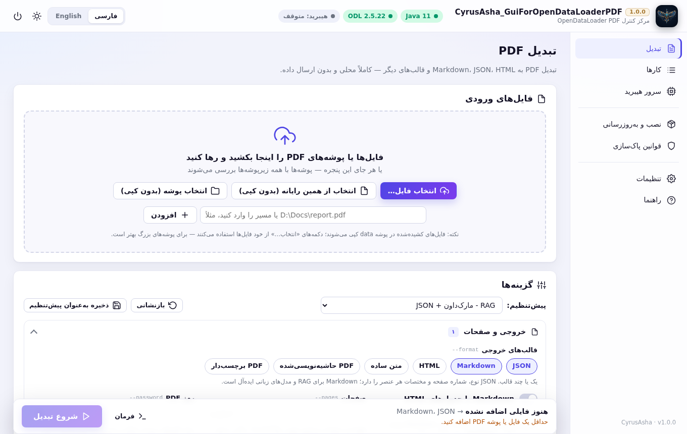 | 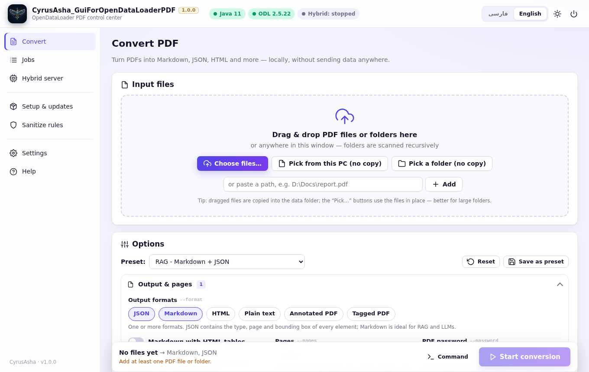 |
| **نتیجه‌ی کار و پیش‌نمایش خروجی / Job result & output preview** | **نصب و به‌روزرسانی / Setup & updates** |
| 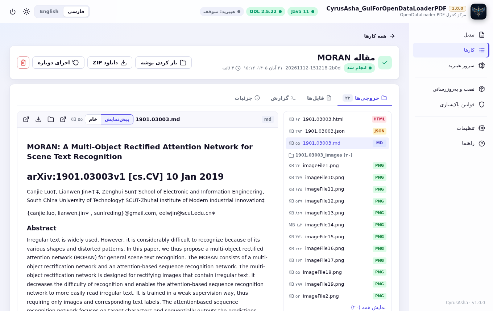 | 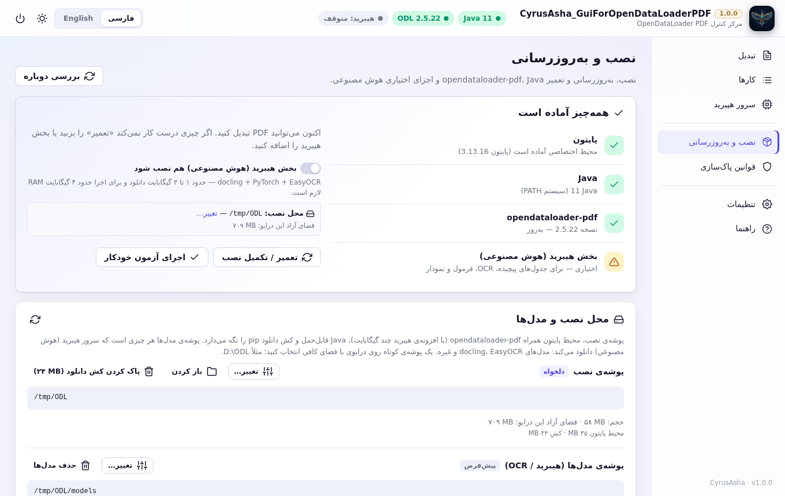 |
| **سرور هیبرید / Hybrid server** | **پوسته‌ی تیره / Dark theme** |
| 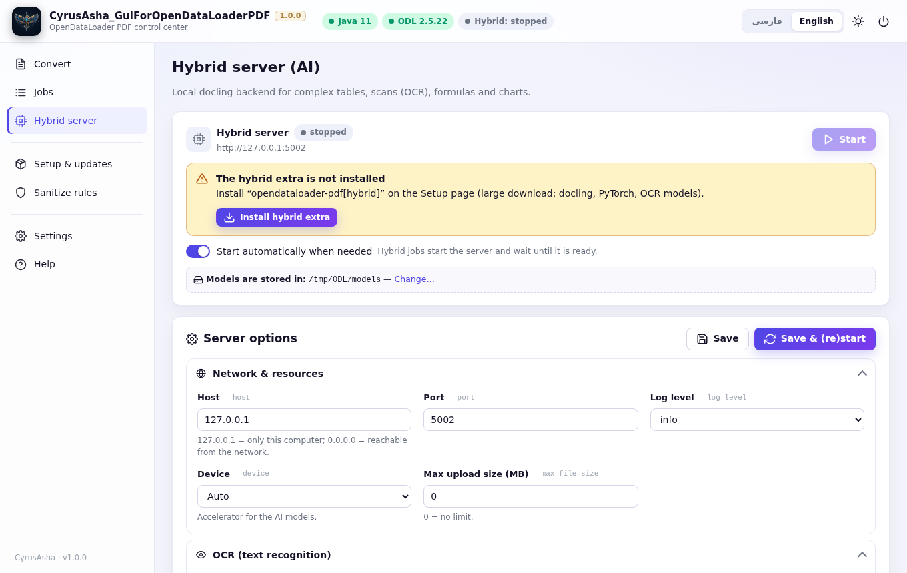 | 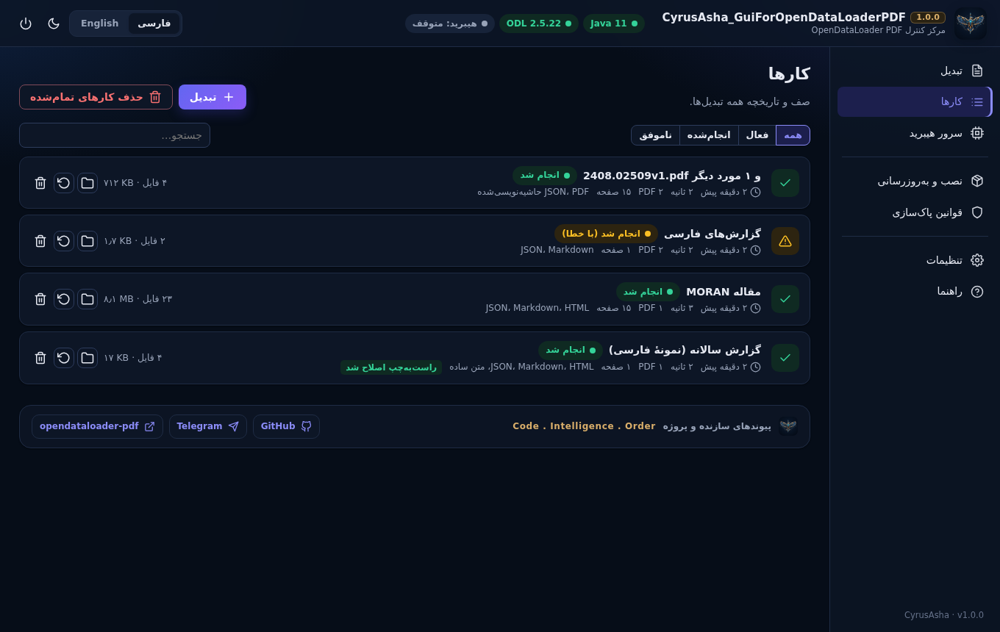 |
| **اصلاح خروجی فارسی / Persian (RTL) output repair** | **گزینه‌ی اصلاح راست‌به‌چپ / The RTL repair option** |
| 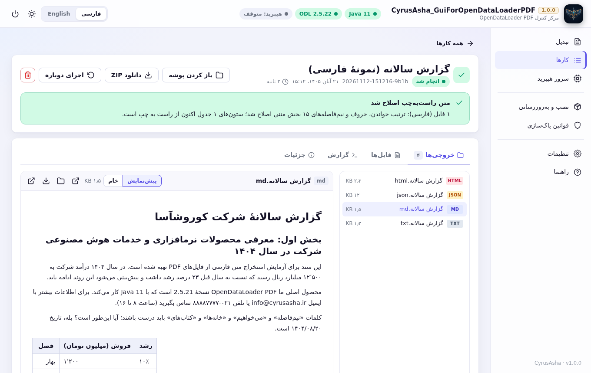 | 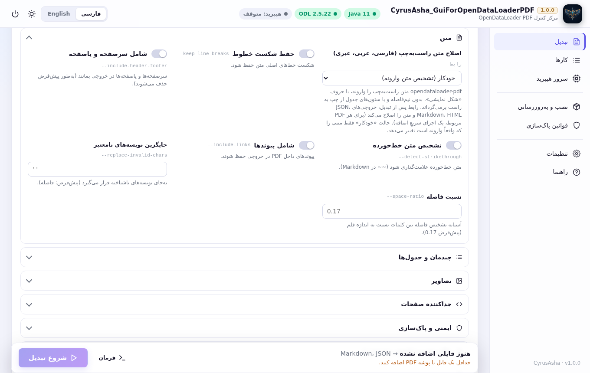 |
| **پنجره‌ی نصب و انتخاب محل / Install dialog with folder choice** | **محل نصب و مدل‌ها / Install & models folders** |
| 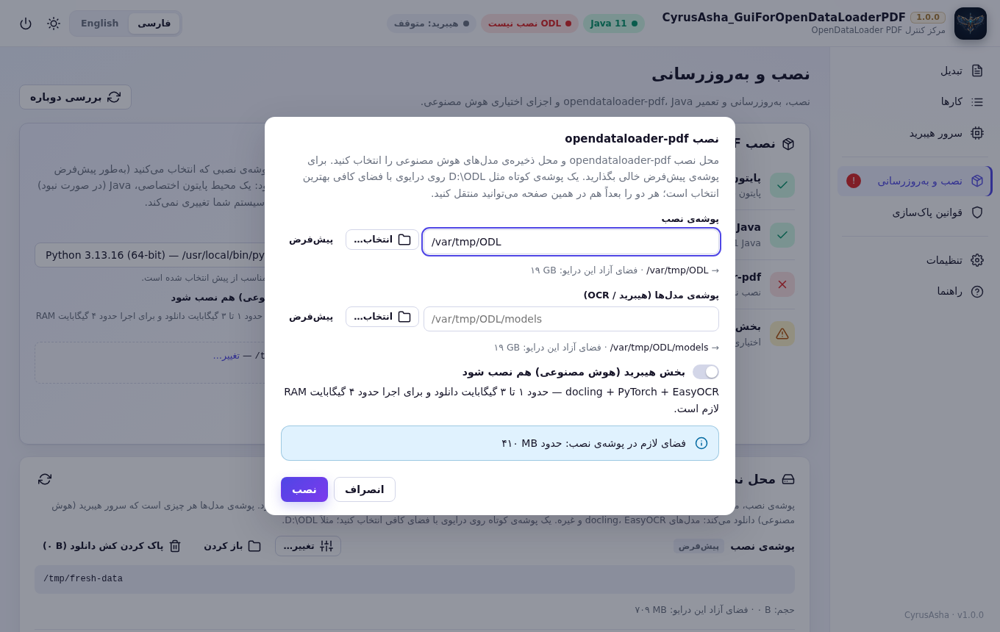 | 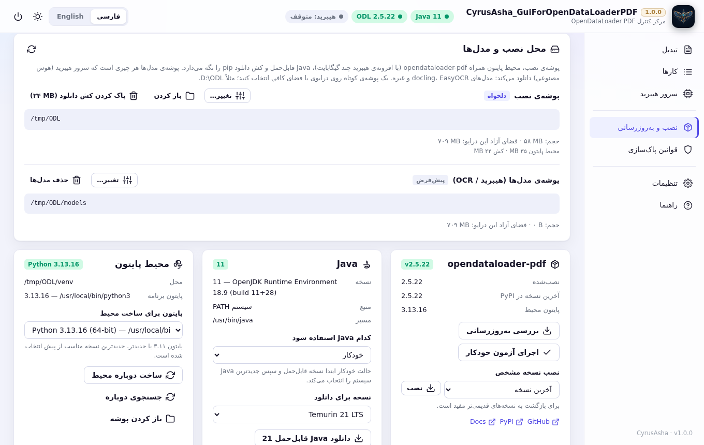 |
| **تغییر پوشه / Changing a folder** | |
| 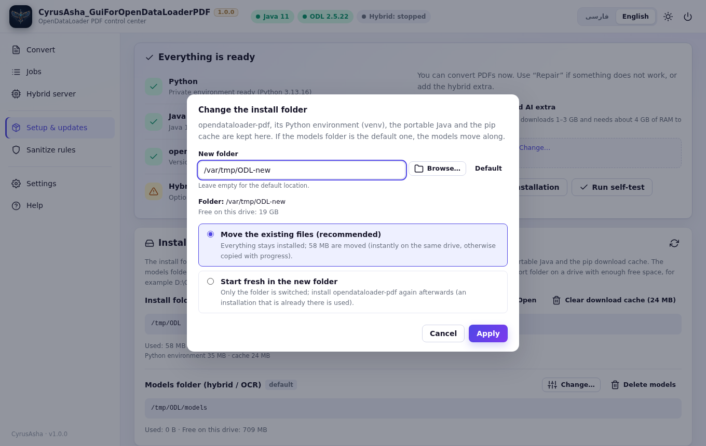 | |

---

## 🧰 Requirements / پیش‌نیازها

<div dir="rtl">

| مورد | توضیح |
|---|---|
| ویندوز ۱۰ یا ۱۱ | روی لینوکس و macOS هم اجرا می‌شود، اما هدف اصلی ویندوز است. |
| پایتون | نسخه‌ی **۳.۹ به بالا** برای اجرای خود برنامه؛ برای محیط opendataloader-pdf نسخه‌ی **۳.۱۱ به بالا** لازم است. |
| Java | لازم نیست از قبل نصب باشد؛ برنامه نسخه‌ی قابل‌حمل را دانلود می‌کند. |
| مرورگر | Microsoft Edge (همراه ویندوز) یا Chrome؛ برنامه در پنجره‌ی مستقل بدون زبانه باز می‌شود. |
| اینترنت | فقط برای نصب و به‌روزرسانی؛ تبدیل کاملاً آفلاین است. |

</div>

| Item | Notes |
|---|---|
| Windows 10 or 11 | Also runs on Linux and macOS, but Windows is the main target. |
| Python | **3.9+** to run the program; the opendataloader-pdf environment needs **3.11+**. |
| Java | Does not need to be installed beforehand; the program downloads a portable runtime. |
| Browser | Microsoft Edge (built into Windows) or Chrome; the program opens in a standalone window without tabs. |
| Internet | Only for installing and updating; conversion works fully offline. |

<div dir="rtl">

به Node.js و ‎.NET نیازی نیست. پایتون انتخاب شده چون opendataloader-pdf رسماً به‌صورت بسته‌ی پایتون منتشر می‌شود (فایل JAR داخل همان بسته است) و سرور هیبرید هم پایتونی است.

</div>

Node.js and .NET are not required. Python was chosen because opendataloader-pdf is officially distributed as a Python package (the JAR is bundled inside it) and the hybrid server is written in Python as well.

---

## 🚀 Installation & first run / نصب و اجرا

<div dir="rtl">

۱. فایل ZIP نسخه‌ی انتشار را از بخش **Releases** دریافت و در مسیری دلخواه (مثلاً `D:\Tools`) استخراج کنید؛ یا مخزن را clone کنید.

۲. روی **`Start.bat`** دوبار کلیک کنید. چون هنوز چیزی نصب نیست، صفحه‌ی **«نصب و به‌روزرسانی»** باز می‌شود؛ روی **«نصب همه‌چیز»** بزنید. پنجره‌ی نصب می‌پرسد opendataloader-pdf و مدل‌های هوش مصنوعی **کجا** نصب شوند (پیش‌فرض: پوشه‌ی `data`) و فضای لازم را با فضای آزاد درایو مقایسه می‌کند.

۳. پس از پایان نصب، فایل‌های PDF را به پنجره بکشید، یک پیش‌تنظیم انتخاب کنید و **«شروع تبدیل»** را بزنید.

</div>

1. Download the release ZIP from **Releases** and extract it anywhere (e.g. `D:\Tools`), or clone the repository.
2. Double-click **`Start.bat`**. Because nothing is installed yet, the **“Setup & updates”** page opens; click **“Install everything”**. The install dialog asks **where** opendataloader-pdf and the AI models should go (default: the `data` folder) and compares the space needed with the free space of the drive.
3. When the installation has finished, drag PDF files into the window, pick a preset and click **“Start conversion”**.

```bat
git clone https://github.com/hamzeh-asadi/CyrusAsha_GuiForOpenDataLoaderPDF.git
cd CyrusAsha_GuiForOpenDataLoaderPDF
Start.bat
```

<div dir="rtl">

اگر نصب کنسولی را ترجیح می‌دهید، `windows\install.bat` را اجرا کنید (برای نصب بخش هیبرید: `windows\install.bat --hybrid`)؛ این برنامه پوشه‌ی نصب و پوشه‌ی مدل‌ها را می‌پرسد (Enter = همان پوشه‌ی نمایش‌داده‌شده). اگر پایتون نصب نباشد، نصب پایتون ۳.۱۳ با `winget` پیشنهاد می‌شود و در پایان می‌توانید میان‌بر دسکتاپ با لوگوی CyrusAsha بسازید.

</div>

If you prefer a console installation, run `windows\install.bat` (add `--hybrid` for the AI extra); it asks for the install and models folders (Enter keeps the folder shown). When Python is missing it offers to install Python 3.13 with `winget`, and at the end it can create a desktop shortcut with the CyrusAsha logo.

<div dir="rtl">

| فایل | کاربرد |
|---|---|
| `Start.bat` | اجرای برنامه با دوبار کلیک (فراخوانی `windows\start-gui.bat`). |
| `windows\start-gui.bat` | اجرا با پنجره‌ی کنسول برای دیدن گزارش‌ها. |
| `windows\start-silent.bat` | اجرا بدون کنسول (`pythonw`)؛ چند دقیقه پس از بستن آخرین پنجره خودکار بسته می‌شود. |
| `windows\install.bat` | نصب کنسولی همه‌ی اجزا. |
| `windows\install-shortcut.ps1` | ساخت میان‌بر دسکتاپ با آیکون CyrusAsha. |
| `windows\diagnose.bat` | گزارش کامل محیط (پایتون، Java، محیط مجازی، بسته‌ها) برای درخواست کمک. |

</div>

| File | Purpose |
|---|---|
| `Start.bat` | Start the program with a double-click (calls `windows\start-gui.bat`). |
| `windows\start-gui.bat` | Start with a console window that shows the log. |
| `windows\start-silent.bat` | Start without a console (`pythonw`); exits automatically a few minutes after the last window is closed. |
| `windows\install.bat` | Console installation of all components. |
| `windows\install-shortcut.ps1` | Create a desktop shortcut with the CyrusAsha icon. |
| `windows\diagnose.bat` | Full environment report (Python, Java, virtual environment, packages) for support requests. |

<div dir="rtl">

برنامه روی نشانی `http://127.0.0.1:8765/` اجرا می‌شود. اجرای دوباره‌ی `Start.bat` به‌جای نسخه‌ی دوم، همان پنجره‌ی قبلی را باز می‌کند. برای خروج از دکمه‌ی ⏻ در نوار بالا استفاده کنید.

</div>

The program runs at `http://127.0.0.1:8765/`. Starting `Start.bat` again brings up the existing instance instead of a second one. Use the ⏻ button in the top bar to exit.

## 📂 Install & models folders / محل نصب و مدل‌ها

<div dir="rtl">

**چرا مهم است؟** محیط پایتون opendataloader-pdf با بخش هیبرید چند گیگابایت می‌شود (docling، PyTorch، EasyOCR) و سرور هیبرید در اولین اجرا مدل‌های هوش مصنوعی را دانلود می‌کند که آن هم چند گیگابایت است. به‌طور پیش‌فرض همه‌چیز در پوشه‌ی `data` کنار برنامه قرار می‌گیرد، اما می‌توانید هر دو را روی درایو دلخواه بگذارید — مثلاً اگر درایو `C:` کم‌جاست.

| پوشه | محتوا | پیش‌فرض |
|---|---|---|
| **پوشه‌ی نصب** | `venv` (opendataloader-pdf و وابستگی‌ها)، `java` (Java قابل‌حمل)، `cache` (کش دانلود و فایل‌های موقت pip) | `data` |
| **پوشه‌ی مدل‌ها** | `huggingface` (مدل‌های docling: چیدمان، جدول، فرمول، توضیح تصویر)، `easyocr`، `docling`، `modelscope` (RapidOCR)، `torch` | `<پوشه‌ی نصب>\models` |

**تغییر محل:** صفحه‌ی «نصب و به‌روزرسانی» ← کارت **«محل نصب و مدل‌ها»** ← **«تغییر…»**. پوشه را با پنجره‌ی ویندوز انتخاب یا تایپ کنید؛ برنامه بلافاصله آن را بررسی می‌کند (قابل نوشتن بودن، فضای آزاد، طول مسیر، نویسه‌های غیرانگلیسی، وجود نصب قبلی) و برای پوشه‌ی غیرخالی یک زیرپوشه‌ی جدا پیشنهاد می‌دهد. سپس یکی از دو حالت را برگزینید:

- **انتقال فایل‌های فعلی (پیشنهادی):** همه‌چیز نصب‌شده می‌ماند. روی همان درایو جابه‌جایی فوری است؛ روی درایو دیگر کپی با نوار پیشرفت و امکان لغو انجام می‌شود و پوشه‌ی قبلی پس از کپی کامل حذف می‌شود. هیچ فایلی بازنویسی نمی‌شود و اگر خطایی رخ دهد، پوشه‌های منتقل‌شده برمی‌گردند و تنظیم تغییر نمی‌کند.
- **شروع تازه:** فقط پوشه عوض می‌شود (و در صورت انتخاب، فایل‌های قبلی حذف می‌شوند)؛ پس از آن دوباره نصب کنید. اگر در پوشه‌ی جدید از قبل نصبی باشد، همان استفاده می‌شود.

**هنگام اولین نصب** دکمه‌ی «نصب همه‌چیز» پنجره‌ی نصب را باز می‌کند: پوشه‌ی نصب و پوشه‌ی مدل‌ها (هر کدام با انتخاب پوشه، بررسی فوری و دکمه‌ی «پیش‌فرض»)، گزینه‌ی بخش هیبرید و برآورد فضای لازم (حدود ۴۰۰ مگابایت؛ با بخش هیبرید حدود ۶ گیگابایت به‌اضافه‌ی حدود ۳ گیگابایت مدل) در مقایسه با فضای آزاد درایو. نصب کنسولی `windows\install.bat` هم همین دو پوشه را می‌پرسد؛ با `install.bat --install-dir D:\ODL --models-dir E:\models` بدون پرسش نصب می‌کند. همان کارت حجم هر بخش و فضای آزاد درایو را نشان می‌دهد و کش دانلود یا مدل‌ها را با یک کلیک پاک می‌کند.

**به‌روزرسانی برنامه بدون نصب دوباره:** اگر پوشه‌ی نصب را بیرون از پوشه‌ی برنامه گذاشته‌اید (مثلاً `D:\ODL`)، پس از استخراج نسخه‌ی جدید برنامه کافی است در کارت «محل نصب و مدل‌ها» همان پوشه را با حالت **«شروع تازه»** انتخاب کنید؛ نصب موجود و مدل‌های دانلودشده بی‌درنگ استفاده می‌شوند. محل مدل‌ها در صفحه‌ی «سرور هیبرید» و در گزارش هر بار اجرای سرور هم نوشته می‌شود.

**نکته‌های ویندوز:**

- مسیر **کوتاه و فقط‌انگلیسی** مثل `D:\ODL` بهترین انتخاب است. اگر «مسیرهای طولانی» ویندوز (`LongPathsEnabled`) خاموش باشد، فایل‌های عمیق PyTorch یا مدل‌ها از ۲۶۰ نویسه بیشتر می‌شوند و نصب یا دانلود شکست می‌خورد؛ برنامه در این حالت هشدار می‌دهد.
- برخی کتابخانه‌های بومی (OpenCV، نسخه‌های قدیمی docling-parse) مسیرهای دارای نویسه‌ی فارسی را باز نمی‌کنند؛ پوشه‌ی شبکه هم برای محیط پایتون مناسب نیست.
- پوشه‌ی `data` (تنظیمات، کارها، گزارش‌ها) سر جای خود می‌ماند؛ خروجی تبدیل‌ها را می‌توانید در تنظیمات ← «پوشه‌ی خروجی پیش‌فرض» هر جا بفرستید.

**جزئیات فنی:** برنامه برای سرور هیبرید متغیرهای `HF_HOME`، `EASYOCR_MODULE_PATH`، `DOCLING_CACHE_DIR`، `MODELSCOPE_CACHE`، `TORCH_HOME` و `XDG_CACHE_HOME` را روی پوشه‌ی مدل‌ها و برای pip متغیرهای `PIP_CACHE_DIR` و `TEMP` را روی پوشه‌ی نصب تنظیم می‌کند؛ بنابراین چیزی در پوشه‌ی کاربر روی درایو `C:` دانلود نمی‌شود. در خط فرمان: `python src\main.py --setup full --hybrid --install-dir D:\ODL --models-dir E:\ODL-models` (فقط تنظیم را ذخیره می‌کند و فایلی منتقل نمی‌شود).

</div>

**Why it matters:** with the hybrid extra the Python environment of opendataloader-pdf grows to several gigabytes (docling, PyTorch, EasyOCR), and on its first start the hybrid server downloads AI models of several more gigabytes. By default everything goes into the `data` folder next to the program, but both parts can live on any drive — for example when drive `C:` is short on space.

| Folder | Contents | Default |
|---|---|---|
| **Install folder** | `venv` (opendataloader-pdf and its dependencies), `java` (portable Java), `cache` (pip download cache and temporary files) | `data` |
| **Models folder** | `huggingface` (docling models: layout, tables, formulas, picture descriptions), `easyocr`, `docling`, `modelscope` (RapidOCR), `torch` | `<install folder>\models` |

**Changing a folder:** “Setup & updates” page → **“Install and models folders”** card → **“Change…”**. Pick a folder with the Windows dialog or type it; it is checked right away (writable, free space, path length, non-English characters, existing installation), and a sub-folder of its own is suggested for a non-empty folder. Then choose one of two modes:

- **Move the existing files (recommended):** everything stays installed. On the same drive the folders are renamed instantly; to another drive they are copied with progress and can be canceled, and the old folder is deleted after a complete copy. Nothing is ever overwritten; if something fails, already moved folders are moved back and the setting does not change.
- **Start fresh:** only the folder is switched (optionally deleting the old files); install again afterwards. An installation that already exists in the new folder is used.

**On the first installation** “Install everything” opens the install dialog: the install and models folders (each with a folder picker, an immediate check and a “Default” button), the hybrid option and an estimate of the space needed (about 400 MB; with the hybrid extra about 6 GB plus about 3 GB of models) compared with the free space of the drive. The console installer `windows\install.bat` asks for the same two folders; `install.bat --install-dir D:\ODL --models-dir E:\models` installs without asking. The same card shows the size of every part and the free space of the drive, and clears the download cache or the models with one click.

**Updating the program without reinstalling:** if the install folder lives outside the program folder (for example `D:\ODL`), extract the new program version and choose that folder in the “Install and models folders” card with **“Start fresh”**; the existing installation and the downloaded models are used right away. The models folder is also shown on the “Hybrid server” page and written to the log at every server start.

**Windows notes:**

- A **short, English-only** path such as `D:\ODL` is the best choice. With Windows long paths (`LongPathsEnabled`) disabled, deep PyTorch or model files exceed 260 characters and the installation or download fails; the program warns about it.
- Some native libraries (OpenCV, older docling-parse) cannot open paths with Persian characters, and a network folder is a poor place for a Python environment.
- The `data` folder (settings, jobs, logs) stays where it is; conversion outputs can go anywhere with Settings → “Default output folder”.

**Technical details:** for the hybrid server the program points `HF_HOME`, `EASYOCR_MODULE_PATH`, `DOCLING_CACHE_DIR`, `MODELSCOPE_CACHE`, `TORCH_HOME` and `XDG_CACHE_HOME` to the models folder, and for pip `PIP_CACHE_DIR` and `TEMP` to the install folder, so nothing is downloaded into the user profile on drive `C:`. On the command line: `python src\main.py --setup full --hybrid --install-dir D:\ODL --models-dir E:\ODL-models` (only saves the setting; no files are moved).

---

## 🧭 Page guide / راهنمای صفحه‌ها

### 1. Convert / تبدیل

<div dir="rtl">

فایل یا پوشه را بکشید و رها کنید، یا از دکمه‌ها استفاده کنید: «انتخاب فایل…» فایل‌ها را در `data\uploads` کپی می‌کند، اما «انتخاب از همین رایانه» و «انتخاب پوشه» از خود فایل‌ها استفاده می‌کنند. یک پیش‌تنظیم انتخاب کنید؛ هر گزینه نام فارسی، توضیح و نام اصلی پرچم CLI (مثل `--table-method`) را نشان می‌دهد. خروجی در «پوشه‌ی کار» (پیشنهادی) یا «پوشه‌ی دلخواه» نوشته می‌شود و دکمه‌ی «فرمان» خط فرمان معادل را نشان می‌دهد. گزینه‌ی «اصلاح متن راست‌به‌چپ» (برچسب «رابط») خروجی فارسی، عربی و عبری را پس از تبدیل درست می‌کند ([جزئیات](#-persian--rtl-output-repair--اصلاح-خروجی-فارسی-و-راستبهچپ)). کلید `Ctrl+Enter` تبدیل را شروع می‌کند.

</div>

Drag & drop files or folders, or use the buttons: “Choose files…” copies files into `data\uploads`, while “Pick from this PC” and “Pick a folder” use the files in place. Choose a preset; every option shows a label, help text and its real CLI flag (e.g. `--table-method`). Output goes to the managed “job folder” (recommended) or a “custom folder”, and the “Command” button shows the equivalent command line. The “Fix right-to-left text” option (marked “GUI”) repairs Persian, Arabic and Hebrew output after the conversion ([details](#-persian--rtl-output-repair--اصلاح-خروجی-فارسی-و-راستبهچپ)). `Ctrl+Enter` starts the conversion.

### 2. Jobs / کارها

<div dir="rtl">

فهرست همه‌ی کارها با فیلتر و جستجو. صفحه‌ی هر کار وضعیت، پیشرفت و خطاها را نشان می‌دهد و چهار زبانه دارد: **خروجی‌ها** (درخت فایل و پیش‌نمایش)، **فایل‌ها** (نتیجه‌ی هر PDF)، **گزارش** (خروجی زنده‌ی CLI) و **جزئیات** (ورودی‌ها، گزینه‌ها و خط فرمان). وضعیت «انجام شد (با خطا)» یعنی برخی فایل‌ها تبدیل شده‌اند و برخی نه — مثلاً یک فایل رمزدار در پوشه. اگر متن راست‌به‌چپ اصلاح شده باشد، پیام سبز «متن راست‌به‌چپ اصلاح شد» و نشان «راست‌به‌چپ اصلاح شد» نمایش داده می‌شود؛ پیش‌نمایش Markdown جهت هر بند و هر جدول را خودکار تعیین می‌کند.

</div>

A list of all jobs with filters and search. Each job page shows state, progress and errors and has four tabs: **Outputs** (file tree and preview), **Files** (per-PDF result), **Log** (live CLI output) and **Details** (inputs, options and command line). “Done with errors” means some files were converted and some were not — for example one encrypted PDF in a folder. When right-to-left text was repaired, a green “Right-to-left text repaired” note and an “RTL fixed” badge are shown; the Markdown preview picks the direction of every paragraph and table automatically.

### 3. Setup & updates / نصب و به‌روزرسانی

<div dir="rtl">

کارت وضعیت، پایتون، Java، opendataloader-pdf و بخش هیبرید را بررسی می‌کند و محل نصب را نشان می‌دهد. کارت «محل نصب و مدل‌ها» پوشه‌ی نصب و پوشه‌ی مدل‌ها را با حجم و فضای آزاد نمایش می‌دهد و تغییر و انتقال آن‌ها را ممکن می‌کند ([جزئیات](#-install--models-folders--محل-نصب-و-مدلها)). در کارت‌های جداگانه می‌توانید نسخه‌ی مشخصی نصب کنید، آزمون خودکار بگیرید، حالت Java را انتخاب کنید (خودکار / فقط قابل‌حمل / فقط سیستم / مسیر دلخواه)، مفسر پایتون محیط را عوض کنید و موتورهای OCR را نصب کنید. پنل نصب، مراحل و گزارش کامل را زنده نشان می‌دهد و قابل لغو است.

</div>

The status card checks Python, Java, opendataloader-pdf and the hybrid extra and shows the install folder. The “Install and models folders” card shows both folders with sizes and free space and changes or moves them ([details](#-install--models-folders--محل-نصب-و-مدلها)). Separate cards let you install a specific version, run the self-test, choose the Java mode (automatic / portable only / system only / custom path), change the environment's Python interpreter and install OCR engines. The installer panel shows the steps and the full log live and can be canceled.

### 4. Sanitize rules / قوانین پاک‌سازی

<div dir="rtl">

قوانین Regex برای جایگزینی داده‌های حساس در `data\rules` ذخیره می‌شوند و قوانین پیش‌فرض رسمی پروژه از ابتدا موجود است. ویرایش جدولی یا JSON، آزمایش روی متن نمونه (مثلاً شماره‌ی موبایل ایرانی با الگوی `09\d{9}`) و وارد کردن با کشیدن فایل JSON روی صفحه پشتیبانی می‌شود. محدودیت‌ها مطابق مستندات رسمی است: حداکثر ۲۰۰ قانون، شناسه‌ی `[a-z0-9-]`، الگو تا ۵۰۰۰ و جایگزین تا ۲۰۰ نویسه.

</div>

Regex rules that replace sensitive data are stored in `data\rules`; the project’s official default rules are included. Table or JSON editing, tests on sample text (e.g. an Iranian mobile number with the pattern `09\d{9}`) and import by dropping a JSON file onto the page are supported. Limits follow the official documentation: max. 200 rules, IDs `[a-z0-9-]`, patterns up to 5000 and replacements up to 200 characters.

### 5. Settings & help / تنظیمات و راهنما

<div dir="rtl">

در تنظیمات: زبان، پوسته، نحوه‌ی باز شدن برنامه، اعلان‌ها، تعداد کارهای هم‌زمان، حداکثر حافظه‌ی Java (`-Xmx`)، پوشه‌ی خروجی پیش‌فرض، پراکسی، آینه‌ی pip و دانلود Java و ساخت میان‌بر دسکتاپ؛ تغییرات خودکار ذخیره می‌شوند. صفحه‌ی راهنما شروع سریع، جدول «کدام حالت؟»، رفع اشکال و گزارش برنامه را دارد.

</div>

Settings cover language, theme, how the program opens, notifications, parallel jobs, max. Java memory (`-Xmx`), the default output folder, proxy, pip and Java download mirrors, and the desktop shortcut; changes are saved automatically. The Help page contains a quick start, the “Which mode?” table, troubleshooting and the application log.

<div dir="rtl">

| کلید | کار |
|---|---|
| `Ctrl` + `Enter` | شروع تبدیل |
| `Ctrl` + `O` | انتخاب فایل |
| `Alt` + `1` … `7` | رفتن به صفحه‌ها |

</div>

| Keys | Action |
|---|---|
| `Ctrl` + `Enter` | Start the conversion |
| `Ctrl` + `O` | Choose files |
| `Alt` + `1` … `7` | Switch pages |

---

## 🤖 Hybrid mode (AI) / حالت هیبرید (هوش مصنوعی)

<div dir="rtl">

حالت هیبرید صفحات پیچیده — جدول‌های پیچیده، اسناد اسکن‌شده، فرمول‌ها و نمودارها — را به یک سرور محلی **docling** می‌فرستد. ابتدا در صفحه‌ی نصب «نصب بخش هیبرید» را بزنید (۱ تا ۳ گیگابایت)، سپس در صفحه‌ی تبدیل موتور هیبرید را روی `docling-fast` بگذارید. با روشن بودن «اجرای خودکار»، سرور هنگام نیاز اجرا می‌شود و کار تا آماده شدن آن صبر می‌کند؛ اولین اجرا مدل‌ها را دانلود می‌کند و چند دقیقه طول می‌کشد.

</div>

Hybrid mode sends complex pages — complex tables, scanned documents, formulas and charts — to a local **docling** server. First click “Install hybrid extra” on the Setup page (1–3 GB), then set the hybrid backend to `docling-fast` on the Convert page. With “auto-start” on, the server starts when needed and the job waits until it is ready; the first start downloads the models and takes a few minutes.

<div dir="rtl">

| نیاز | تنظیم |
|---|---|
| جدول‌های پیچیده | `docling-fast` با تنظیمات پیش‌فرض |
| اسکن‌شده / OCR | سرور: حالت OCR = اجباری (پیش‌تنظیم «اسکن‌شده / OCR») |
| فرمول ← LaTeX | تبدیل: صفحات ارسالی = کامل + سرور: «فرمول ← LaTeX» |
| توضیح تصاویر | تبدیل: صفحات ارسالی = کامل + سرور: «توضیح تصاویر و نمودارها» |
| اسکن فارسی | سرور: OCR اجباری + EasyOCR با `fa,en` یا Tesseract با `fas,eng` |

</div>

| Need | Settings |
|---|---|
| Complex tables | `docling-fast` with defaults |
| Scans / OCR | Server: OCR mode = Force (preset “Scanned / OCR”) |
| Formulas → LaTeX | Conversion: pages sent = Full + server: “Formulas → LaTeX” |
| Picture descriptions | Conversion: pages sent = Full + server: “Describe pictures & charts” |
| Persian scans | Server: force OCR + EasyOCR with `fa,en` or Tesseract with `fas,eng` |

<div dir="rtl">

پیش‌نیازها: ۲ تا ۴ گیگابایت RAM آزاد؛ GPU اختیاری است. اگر سرور در دسترس نباشد، گزینه‌ی «بازگشت به حالت محلی» (`--hybrid-fallback`) کار را با موتور Java ادامه می‌دهد. محدودیت پروژه‌ی اصلی: ترتیب خواندن راست‌به‌چپ در خروجی OCR کامل پشتیبانی نمی‌شود.

</div>

Requirements: 2–4 GB of free RAM; a GPU is optional. If the server is unreachable, “Fall back to native mode” (`--hybrid-fallback`) continues with the Java engine. Upstream limitation: right-to-left reading order in OCR output is limited.

---

## ⚠️ Python 3.15 note / نکته پایتون ۳.۱۵

<div dir="rtl">

خود برنامه و opendataloader-pdf (حالت محلی) روی پایتون ۳.۱۵ بدون مشکل کار می‌کنند. اما برای **بخش هیبرید**، در زمان انتشار این نسخه (نوامبر ۲۰۲۶) دو وابستگی EasyOCR یعنی `scikit-image` و `pyclipper` هنوز نسخه‌ی آماده‌ی ویندوز (wheel) برای cp315 ندارند و pip باید آن‌ها را کامپایل کند که بدون Microsoft C++ Build Tools ناموفق است.

</div>

The program and opendataloader-pdf (native mode) work fine on Python 3.15. For the **hybrid extra**, however, at the time of this release (November 2026) two EasyOCR dependencies — `scikit-image` and `pyclipper` — do not yet ship Windows wheels for cp315, so pip would have to compile them, which fails without Microsoft C++ Build Tools.

<div dir="rtl">

برنامه این را خودش مدیریت می‌کند: پیش از دانلود سنگین، یک بررسی اولیه (`pip install --dry-run --report`) انجام می‌شود و در صورت مشکل دکمه‌ی **«ساخت دوباره با پایتون ۳.۱۳/۳.۱۴»** نمایش داده می‌شود. پیشنهاد: پایتون ۳.۱۳ را هم نصب کنید (`winget install -e --id Python.Python.3.13`) و در صفحه‌ی نصب برای محیط انتخابش کنید؛ خود برنامه همچنان می‌تواند با ۳.۱۵ اجرا شود.

</div>

The program handles this itself: before the heavy download it runs a pre-check (`pip install --dry-run --report`) and, if that fails, offers **“Recreate with Python 3.13/3.14”**. Recommendation: also install Python 3.13 (`winget install -e --id Python.Python.3.13`) and select it for the environment on the Setup page; the program itself can keep running on 3.15.

---

## ⌨️ Command line / خط فرمان

<div dir="rtl">

همه‌ی launcherها در نهایت `src\main.py` را اجرا می‌کنند و همین فایل را می‌توان مستقیم با گزینه‌های زیر به کار برد. عملیات‌های `--setup` همان نصب‌کننده‌ی رابط گرافیکی را بدون رابط اجرا می‌کنند.

</div>

All launchers end up running `src\main.py`, which can also be used directly with the options below. The `--setup` actions run the same installer as the GUI, without a window.

```text
python src\main.py [options]

  --host HOST          interface to bind (default 127.0.0.1 = this computer only)
  --port PORT          TCP port (default 8765; the next free port is used if busy)
  --data DIR           data folder (default: data\ in the project root)
  --browser            open in the default browser tab
  --app                open in an Edge/Chrome app window
  --no-browser         only start the server
  --exit-when-idle [S] exit when no window has been open for S seconds (default 180)
  --no-host-check      accept any Host header (behind a reverse proxy)
  --setup ACTION       full | install | update | hybrid | rapidocr | tesseract | java-portable |
                       java-winget | java-remove | venv | verify | uninstall | reset
  --hybrid             with --setup full: also install the hybrid extra
  --python PATH        with --setup: interpreter used to create the environment
  --pkg-version X.Y.Z  with --setup install: exact opendataloader-pdf version
  --install-dir DIR    install folder for venv, Java and pip cache ("" = data folder); saved, no files are moved
  --models-dir DIR     folder for downloaded AI models ("" = <install folder>\models); saved, no files are moved
  --show-locations     print the install and models folders and exit
  --diagnose           print an environment report and exit
  --verbose            debug logging
  --version            print the version
```

```bat
python src\main.py --setup full --hybrid --python "C:\Python313\python.exe"
python src\main.py --setup install --pkg-version 2.5.20
python src\main.py --setup full --hybrid --install-dir D:\ODL --models-dir E:\ODL-models
python src\main.py --diagnose
```

<div dir="rtl">

متغیرهای محیطی `CYRUSASHA_ODL_DATA`، `CYRUSASHA_ODL_HOST` و `CYRUSASHA_ODL_PORT` مقدار پیش‌فرض پوشه‌ی داده، میزبان و پورت را تغییر می‌دهند.

</div>

The environment variables `CYRUSASHA_ODL_DATA`, `CYRUSASHA_ODL_HOST` and `CYRUSASHA_ODL_PORT` change the default data folder, host and port.

---

## 📁 Project structure / ساختار پروژه

<div dir="rtl">

ساختار مخزن مشابه سایر پروژه‌های CyrusAsha است: کد در `src`، launcherهای ویندوز در `windows`، لوگو در `assets`، مستندات در `docs`، ابزارهای ساخت در `scripts` و آزمون‌ها در `test`. پوشه‌ی `data` هنگام اجرا ساخته می‌شود و در Git ثبت نمی‌شود.

</div>

The repository follows the layout of the other CyrusAsha projects: code in `src`, Windows launchers in `windows`, the logo in `assets`, documentation in `docs`, build tools in `scripts` and tests in `test`. The `data` folder is created at runtime and is not committed.

```text
CyrusAsha_GuiForOpenDataLoaderPDF/
├─ Start.bat                         double-click launcher
├─ assets/CyrusAsha_GuiForOpenDataLoaderPDF-logo.png
├─ docs/                             ARCHITECTURE.md, RELEASES.md, screenshots/
├─ scripts/
│  ├─ build-icons.py                 brand PNGs + windows/icon.ico (16-256 px) from the logo
│  ├─ build-release.py               release/CyrusAsha_GuiForOpenDataLoaderPDF-<version>.zip
│  └─ build-rtl-lexicon.py           word list of the RTL repair (from text corpora)
├─ src/
│  ├─ main.py                        entry point (server, UI launcher, --setup, --diagnose)
│  ├─ cyrusasha_odl/                 backend - Python standard library only
│  │  ├─ app.py  server.py  config.py  env.py  setup_tasks.py
│  │  ├─ jobs.py  hybrid.py  rules.py  procs.py  platform_utils.py  errors.py
│  │  ├─ rtl.py                      repair of Persian/Arabic/Hebrew output (bidi, letters, tables)
│  │  ├─ storage.py                  install/models folders: sizes, checks, moving, model env variables
│  │  ├─ data/rtl-words.txt.gz       ranked word lists for the ligature repair (CC BY-SA 4.0)
│  │  └─ default-rules.json          official sanitize rules (Apache-2.0)
│  └─ gui/public/                    web UI - plain HTML/CSS/JS, no build step
│     ├─ index.html  css/  js/       i18n.js holds the Persian and English texts
│     └─ brand/                      CyrusAsha emblem, favicon, full logo
├─ test/                             unittest suites (+ optional Playwright GUI test)
│  └─ fixtures/rtl/                  Persian test PDF and real opendataloader-pdf outputs
├─ windows/                          start-gui, start-silent, install, diagnose, icon.ico
└─ data/                             created at runtime: venv, java, cache, models (unless moved), jobs, uploads, rules, logs
```

<div dir="rtl">

جزئیات معماری، جریان داده و فهرست کامل API در [`docs/ARCHITECTURE.md`](docs/ARCHITECTURE.md) آمده است.

</div>

Architecture details, the data flow and the complete API are documented in [`docs/ARCHITECTURE.md`](docs/ARCHITECTURE.md).

---

## 🧪 Tests & release build / آزمون و ساخت انتشار

<div dir="rtl">

آزمون‌ها فقط به کتابخانه‌ی استاندارد پایتون نیاز دارند و اعتبارسنجی‌ها، امنیت مسیرها، ساخت آرگومان‌ها، پوشش کامل ترجمه‌ی فارسی/انگلیسی، قراردادهای launcherها (ASCII و CRLF)، یک آزمون واقعی API، اصلاح خروجی راست‌به‌چپ (روی خروجی‌های واقعی opendataloader-pdf در `test/fixtures/rtl`) و تغییر و انتقال پوشه‌ی نصب و مدل‌ها را بررسی می‌کنند. آزمون رابط گرافیکی اختیاری است و به Playwright نیاز دارد؛ آزمون سرتاسری اصلاح راست‌به‌چپ با CLI واقعی هم اختیاری است و با متغیر `ODL_TEST_PYTHON` فعال می‌شود.

</div>

The tests need only the Python standard library and cover validation, path safety, argument building, complete Persian/English translation coverage, launcher conventions (ASCII and CRLF), a real API smoke test, the right-to-left repair (on real opendataloader-pdf outputs in `test/fixtures/rtl`) and changing/moving the install and models folders. The GUI test is optional and needs Playwright; the end-to-end RTL test with the real CLI is optional too and is enabled with the `ODL_TEST_PYTHON` variable.

```bat
python -m unittest discover -s test -v

:: optional end-to-end RTL test with the real CLI (Python of the private venv)
set ODL_TEST_PYTHON=data\venv\Scripts\python.exe
python -m unittest test.test_rtl -v

:: optional GUI test
pip install playwright
python -m playwright install chromium
python -m unittest test.test_gui -v

:: brand assets (needs Pillow) and the release ZIP (standard library only)
python scripts\build-icons.py
python scripts\build-release.py
```

<div dir="rtl">

خروجی `build-release.py` فایل `release\CyrusAsha_GuiForOpenDataLoaderPDF-1.0.0.zip` به‌همراه checksum آن (`.sha256`) است؛ این فایل را به GitHub Releases پیوست کنید. مراحل کامل انتشار در [`docs/RELEASES.md`](docs/RELEASES.md) آمده است.

</div>

`build-release.py` produces `release\CyrusAsha_GuiForOpenDataLoaderPDF-1.0.0.zip` plus its checksum (`.sha256`); attach both to GitHub Releases. The complete publishing steps are in [`docs/RELEASES.md`](docs/RELEASES.md).

---

## 🔒 Privacy & security / حریم خصوصی و امنیت

<div dir="rtl">

- **پردازش محلی:** تبدیل کاملاً روی همین رایانه انجام می‌شود؛ هیچ محتوایی به سرور یا سرویس تحلیلی فرستاده نمی‌شود. اتصال اینترنت فقط برای PyPI، دانلود Java و (در حالت هیبرید) دانلود مدل‌ها استفاده می‌شود.
- **دسترسی محدود:** سرور فقط روی `127.0.0.1` گوش می‌دهد و سرآیند `Host` بررسی می‌شود (جلوگیری از DNS rebinding). درخواست‌های تغییردهنده به سرآیند اختصاصی `X-CyrusAsha-ODL` نیاز دارند (جلوگیری از CSRF).
- **پیش‌نمایش امن:** فایل‌های HTML/SVG تولیدشده با `Content-Security-Policy: sandbox` نمایش داده می‌شوند و Markdown از فهرست سفید HTML عبور می‌کند؛ PDF مخرب نمی‌تواند در رابط اسکریپت اجرا کند. دسترسی به فایل‌ها فقط داخل پوشه‌ی خروجی همان کار مجاز است.
- **رمزها:** رمز PDF هرگز روی دیسک ذخیره نمی‌شود — نه در تاریخچه و نه در پیش‌تنظیم‌ها. دستورها بدون shell اجرا می‌شوند.
- **هشدار:** اگر با `--host 0.0.0.0` اجرا کنید، برنامه در شبکه در دسترس است و رمز ورود ندارد؛ فقط در شبکه‌ی مورد اعتماد.

</div>

- **Local processing:** conversion happens entirely on this computer; no content is sent to any server or analytics service. The internet is used only for PyPI, the Java download and (in hybrid mode) the model download.
- **Restricted access:** the server listens on `127.0.0.1` only and checks the `Host` header (DNS-rebinding protection). State-changing requests require the custom `X-CyrusAsha-ODL` header (CSRF protection).
- **Safe previews:** generated HTML/SVG files are served with `Content-Security-Policy: sandbox`, and Markdown passes an HTML whitelist; a malicious PDF cannot run scripts in the UI. File access is restricted to the output folder of the respective job.
- **Passwords:** PDF passwords are never written to disk — neither to the history nor to presets. Commands run without a shell.
- **Warning:** with `--host 0.0.0.0` the program is reachable from the network and has no login; use it only on trusted networks.

---

## 🛠️ Troubleshooting / رفع اشکال

| مشکل / Problem | راه‌حل / Solution |
|---|---|
| پایتون پیدا نشد<br>`Python 3.9 or newer was not found` | `windows\install.bat` را اجرا کنید یا پایتون را از python.org نصب کنید.<br>Run `windows\install.bat` or install Python from python.org (“Add python.exe to PATH”). |
| Java پیدا نشد<br>Java not found | صفحه‌ی نصب ← «دانلود Java قابل‌حمل».<br>Setup → “Download portable Java”. |
| دکمه‌های «انتخاب از همین رایانه» کار نمی‌کنند<br>“Pick from this PC” does nothing | به tkinter نیاز است (در نصب‌کننده‌ی رسمی پایتون هست)؛ از کشیدن و رها کردن استفاده کنید.<br>tkinter is required (part of the official installer); use drag & drop instead. |
| خطای شبکه هنگام نصب<br>Network errors while installing | تنظیمات ← شبکه: پراکسی یا آینه‌ی pip و Java.<br>Settings → Network: proxy or pip/Java mirrors. |
| `Could not connect to hybrid backend` | سرور را از صفحه‌ی هیبرید اجرا کنید یا «بازگشت به حالت محلی» را روشن کنید.<br>Start the server on the Hybrid page or enable “Fall back to native mode”. |
| فایل رمزدار<br>Encrypted PDF | رمز را در «خروجی و صفحات» وارد کنید.<br>Enter the password under “Output & pages”. |
| کمبود حافظه برای PDF بزرگ<br>Out of memory on large PDFs | تنظیمات ← «حداکثر حافظه‌ی Java» (مثلاً 4096).<br>Settings → “Max. Java memory” (e.g. 4096). |
| نصب بخش هیبرید با خطای مسیر/فایل شکست می‌خورد<br>Hybrid installation fails with path / file-not-found errors | مسیر نصب احتمالاً بیش از حد طولانی است: در کارت «محل نصب و مدل‌ها» پوشه‌ی کوتاهی مثل `D:\ODL` انتخاب کنید (یا مسیرهای طولانی ویندوز را فعال کنید).<br>The install path is probably too long: choose a short folder such as `D:\ODL` in the “Install and models folders” card (or enable Windows long paths). |
| درایو C پر می‌شود<br>Drive C runs out of space | پوشه‌ی نصب و پوشه‌ی مدل‌ها را به درایو دیگری منتقل کنید و کش دانلود را پاک کنید.<br>Move the install and models folders to another drive and clear the download cache. |
| متن فارسی وارونه یا با حروف جدا<br>Persian text reversed or with detached letters | گزینه‌ی «اصلاح متن راست‌به‌چپ» نباید «خاموش» باشد؛ اگر «خودکار» کافی نبود «همیشه» را امتحان کنید و گزارش کار (`[GUI] RTL repair`) را ببینید.<br>“Fix right-to-left text” must not be “Off”; if “Auto” is not enough try “Always” and check the job log (`[GUI] RTL repair`). |

<div dir="rtl">

گزارش‌ها در `data\logs` (برنامه، نصب، سرور هیبرید) و `data\jobs\<id>\log.txt` ذخیره می‌شوند. برای درخواست کمک، خروجی `windows\diagnose.bat` را پیوست کنید.

</div>

Logs are stored in `data\logs` (application, installer, hybrid server) and `data\jobs\<id>\log.txt`. When asking for help, attach the output of `windows\diagnose.bat`.

---

## 🗑️ Uninstall / حذف برنامه

<div dir="rtl">

برنامه چیزی خارج از پوشه‌ی خودش تغییر نمی‌دهد (مگر اینکه Java یا Tesseract را با winget روی سیستم نصب کرده باشید، یا پوشه‌ی نصب و مدل‌ها را جای دیگری گذاشته باشید). برای حذف کامل، پوشه‌ی پروژه، پوشه‌های نصب و مدل‌های دلخواه (اگر تغییر داده‌اید) و میان‌بر دسکتاپ را پاک کنید.

</div>

The program changes nothing outside its own folder (unless you installed Java or Tesseract system-wide with winget, or moved the install and models folders elsewhere). Delete the project folder, your custom install and models folders (if you changed them) and the desktop shortcut to remove everything.

---

## 🌿 Git & GitHub / Git و GitHub

<div dir="rtl">

- فایل `.gitattributes` متن‌های مخزن را روی LF نرمال می‌کند و برای `.bat` و `.cmd` پایان خط CRLF را نگه می‌دارد، چون cmd.exe به آن نیاز دارد.
- فایل `.gitignore` پوشه‌های `data/` و `release/` و فایل‌های موقت پایتون را نادیده می‌گیرد؛ بسته‌های انتشار را به GitHub Releases پیوست کنید، نه به تاریخچه‌ی سورس.

</div>

- `.gitattributes` normalizes repository text to LF and keeps CRLF for `.bat` and `.cmd` files, which cmd.exe requires.
- `.gitignore` excludes the `data/` and `release/` folders and Python cache files; attach release packages to GitHub Releases instead of the source history.

---

## 🤝 Contributing / مشارکت

<div dir="rtl">

۱. از مخزن **Fork** بگیرید و یک شاخه‌ی جدید بسازید.

۲. پیش از ارسال، `python -m unittest discover -s test -v` را اجرا کنید؛ برای متن‌های جدید هر دو زبان را در `src/gui/public/js/i18n.js` اضافه کنید و برای هر تابع جدید docstring یا JSDoc بنویسید.

۳. یک **Pull Request** ثبت کنید.

</div>

1. **Fork** the repository and create a new branch.
2. Before submitting, run `python -m unittest discover -s test -v`; add both languages for new texts in `src/gui/public/js/i18n.js` and write a docstring or JSDoc block for every new function.
3. Open a **Pull Request**.

---

## 📄 License / مجوز

<div dir="rtl">

این پروژه تحت مجوز متن‌باز **MIT** منتشر شده است ([`LICENSE`](LICENSE)). پروژه‌ی opendataloader-pdf که این برنامه نصبش می‌کند و فایل `default-rules.json` تحت مجوز **Apache-2.0** متعلق به opendataloader-project هستند. فهرست واژه‌ی `src/cyrusasha_odl/data/rtl-words.txt.gz` (برگرفته از ویکی‌پدیا و FrequencyWords) تحت مجوز **CC BY-SA 4.0** است و PDF آزمون `test/fixtures/rtl/fa-sample.pdf` قلم [وزیرمتن](https://github.com/rastikerdar/vazirmatn) (مجوز **OFL-1.1**) را در خود دارد.

</div>

This project is released under the open-source **MIT** license ([`LICENSE`](LICENSE)). opendataloader-pdf, which this program installs, and `default-rules.json` are licensed under **Apache-2.0** by the opendataloader-project. The word list `src/cyrusasha_odl/data/rtl-words.txt.gz` (derived from Wikipedia and FrequencyWords) is licensed **CC BY-SA 4.0**, and the test PDF `test/fixtures/rtl/fa-sample.pdf` embeds the [Vazirmatn](https://github.com/rastikerdar/vazirmatn) font (**OFL-1.1**).

<div dir="rtl">

با سپاس از تیم [opendataloader-pdf](https://github.com/opendataloader-project/opendataloader-pdf)، [Eclipse Adoptium](https://adoptium.net/)، [docling](https://github.com/docling-project/docling)، [FrequencyWords](https://github.com/hermitdave/FrequencyWords) و [وزیرمتن](https://github.com/rastikerdar/vazirmatn).

</div>

Thanks to the [opendataloader-pdf](https://github.com/opendataloader-project/opendataloader-pdf) team, [Eclipse Adoptium](https://adoptium.net/), [docling](https://github.com/docling-project/docling), [FrequencyWords](https://github.com/hermitdave/FrequencyWords) and [Vazirmatn](https://github.com/rastikerdar/vazirmatn).

<div align="center">
  <sub><b>CyrusAsha</b> · Code. Intelligence. Order · <a href="https://github.com/hamzeh-asadi">GitHub</a> · <a href="https://t.me/Asadi_hamzeh">Telegram</a></sub>
</div>
